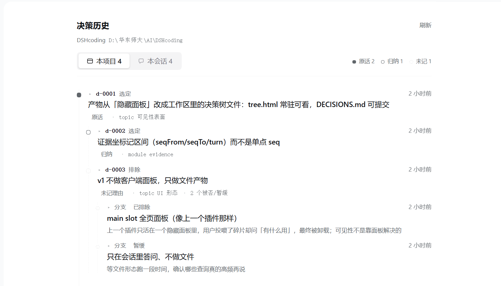
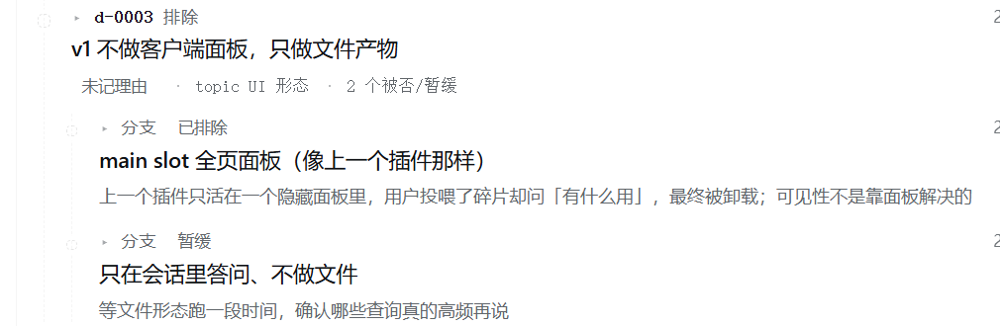

# 决策历史 · Decision History

给 [DSH（DeepSeek Harness）](https://github.com/deepseek-ai/deepseek-harness) 的插件：把「为什么这么定」记成一条**可审计的决策链**，而不是埋在滚屏里。你在一个项目里做出的每个选择，都会长在这棵树上。



> 真机截图：Windows 桌面端 DeepSeek Harness 实际运行，数据取自本项目自身的决策记录。

## 它解决什么

长任务里真正会丢的，不是「做了什么」，而是**为什么这样、当时放弃了什么**：
「这个模块为什么最终没用 X 方案」「第三天改方向的触发条件是什么」——这些话只在会话里出现过一次，三天后连你自己都拼不出来。

普通日志插件记的是「做了什么」和「结论是什么」，记不了「为什么」和「曾经差点走哪条路」。

## 核心：三个诚信标签

每条决策都必须声明理由的来源，不允许含糊：

| 标签 | 含义 | 圆点形态 |
|---|---|---|
| `verbatim` | 会话日志里的**逐字原话**，可用坐标回放 | 实心 |
| `inferred` | 归纳出来的理由，**不是**当时的原话 | 空心 |
| `missing` | 当时没人说明理由。这一格原本就是空的 | 虚线空心 |

`missing` 不是失败，是真信息——它告诉你当时是拍脑袋定的。插件**不会**替你补一个听起来合理的理由；`decision_why` 也会把 `rationaleSource` 和证据坐标原样返回，不允许模型改写成一段通顺的解释。

每条记录都带**证据坐标**：`sessionId + seq 区间 + turn`，可以用 `session_event_read` 回放原文验证。

## 界面

| 元素 | 说明 |
|---|---|
| 竖轴圆点 | 用**形态**区分诚信度（实心/空心/虚线），不靠高饱和红黄绿 |
| 分支 | 被否 / 暂缓的选项以虚线挂在所属决策下面，点开能看当时排除它的原因 |
| 点击一行 | 就地展开：理由、被否项及原因、证据坐标、记录信息 |
| 分段控制 | `本项目`（跨会话汇总）/ `本会话` |


被否 / 暂缓的选项不会消失，而是作为虚线分支挂在所属决策下面，随时能看到「当时差点走哪条路」：



入口在会话标题右侧，显示本项目已有的决策条数；点它打开面板，并自动定位到当前会话所属的项目。

## 安装

在 DSH 里用插件管理器安装本目录（[详细规范](https://github.com/deepseek-ai/deepseek-harness)）：

```text
plugin_manager(action: "install_bundle", target: "<本目录的绝对路径>")
```

装完刷新页面，侧边栏与会话标题右侧会出现入口。

## 用法

**人**（输入框直接发，不会发给模型）：

```text
/decide 用 Zod 而不是 io-ts 做运行时校验 --why "io-ts 维护停滞，运行时开销也高"
/decide why 校验库
/decide list
/decide confirm d-0003 "当时的原话"
```

**模型**（三个工具）：

| 工具 | 用途 |
|---|---|
| `decision_record` | 做出选择后记一条；声明 `verbatim` 时必须同时给 `quote`，否则会降级并告警 |
| `decision_search` | 按关键词 / 对象 / 诚信标签检索，返回结构化条目 |
| `decision_why` | 取某个主题的完整决策链，理由原样透出，缺失的如实标 `missing` |

## 配置

`cordis.patch.yml`：

```yaml
config:
  autoExtract: 'off'    # 见下
  maxEntries: 500
  dir: .decisions
```

关于 `autoExtract`：可选 `off` / `conservative`。`conservative` 会在一轮里「确实改过文件或跑过命令 + 文本里有决策语气 + 能切出 ≥12 字原话」时才自动抽一条，标 `auto` 等你确认。**实测它仍会在"改代码 + 说决策词"的轮次里过度触发**，把实现叙述当成决策，所以默认关闭。宁可漏，不可吵。

## 数据落在哪

都在工作区的 `.decisions/`：

- `decisions.jsonl` — 结构化记录，唯一事实来源（一人可读、可 diff、可提交）
- `DECISIONS.md` — 自动生成的人读版本
- `tree.html` — 独立可打开的树，6 秒自刷新

按会话隔离：每条记录绑定 `sessionId`，不同会话的决策不会混在一起。

## 已知限制

- 面板挂在根级槽位，框架不提供会话绑定；靠会话头部入口（`conversation.session.header.actions` 的 `sessionId` prop）回报当前会话身份
- 面板外的入口（会话头部、侧边栏）必须自带内联样式——面板里的 `<style>` 在那些位置不生效
- 改动 Host 端代码需要**卸载 → 重装**才生效（模块不热重载）
- 未做：fork / 子会话继承父会话的决策链

## License

MIT
